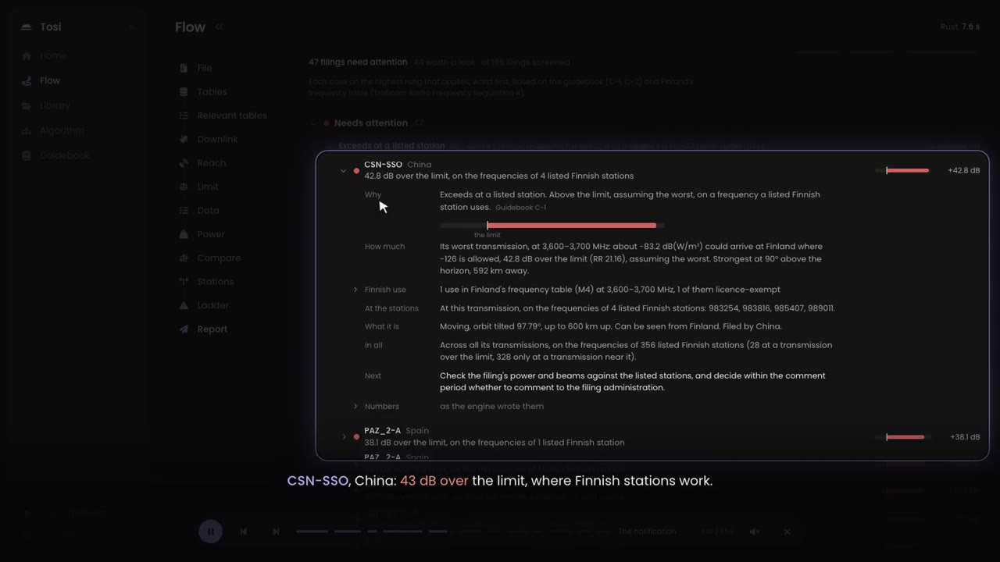

# Tosi

Tosi checks new ITU satellite and terrestrial filings against a country's own use of the radio spectrum, and reports the few that matter: which, where, why, and by how much.

Every result comes from a stated rule, can be reproduced exactly, and opens down to the evidence behind it.

*Tosi* is Finnish for "true".

## See it in two minutes

[](docs/media/tosi-demo.mp4)

**[Watch the demo (MP4, 1:59)](docs/media/tosi-demo.mp4)**

The video is a recording of the **Play demo** button on Tosi's home page: a narrated film that plays over the live app, with every number taken from real runs of the two sample issues (space 3074 and terrestrial 3076). Press it in the app to watch it yourself, pause at any point, and look around.

Narration: Kokoro (Apache-2.0), generated locally. Music: a short piano piece composed and synthesised for this video; no samples, free to reuse.

## What it does

- **Screens both kinds of filing.** Space: does it transmit down, can it rise above Finland's horizon, which ITU limit applies, how much power could arrive in the worst case, and whose stations it could reach. Terrestrial: foreign land mobile stations near enough to matter, their field strength at the border (ITU-R P.1546-6) against the trigger level.
- **A short notification, not a spreadsheet.** Each filing lands on one rung of a concern ladder; the report lists the few that need attention, why, and by how much, as an outline, a table, CSV or Excel.
- **A glass box.** Every line opens down to its rung, the guidebook rule behind it, the step that applied it, and the record in the ITU file.
- **Three engines, one answer.** Every stage is written in TypeScript, Rust and Python from the same specification, and all three write byte-identical results.
- **Rules you can read.** Every number lives in a versioned rulebook, with its source. An AI assistant can reach every step through Tosi's MCP server, but it can only propose; a person approves each change.

## Run it

```bash
node ui/server.ts
```

Then open http://127.0.0.1:5170. Node 26 runs the server's TypeScript directly. More in [docs/README.md](docs/README.md).
